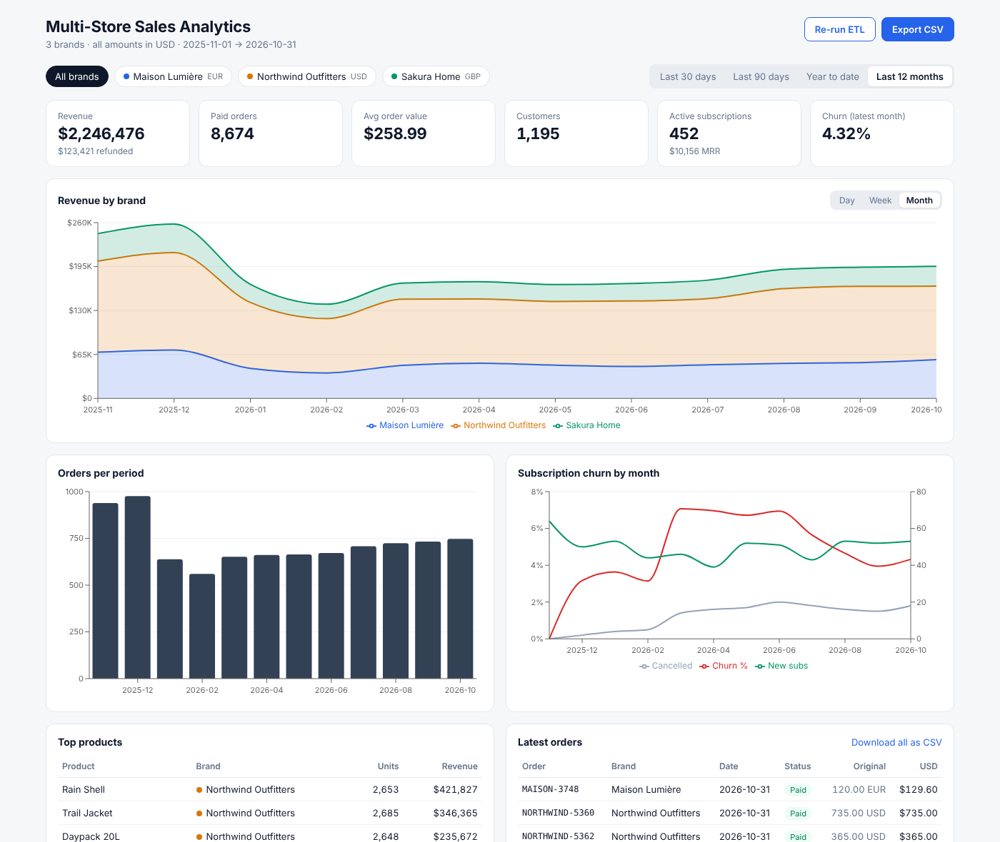

# Multi-Store Sales Analytics Dashboard

A unified reporting dashboard for a business running several e-commerce brands. A Python ETL pipeline pulls order and subscription exports from each brand store, cleans them, converts every amount to USD and loads one reporting schema. A FastAPI service serves the metrics, and a React dashboard shows revenue, orders, churn and top products per brand, with filters and CSV export.



## Features

- **Multi-store ETL**: extracts one Shopify-style JSON export per brand and transforms it:
  - drops test orders and duplicate orders
  - normalises customer emails
  - converts EUR and GBP to USD
  - pre-computes day, week and month buckets
- **Idempotent loads**: re-running the pipeline replaces a brand's rows instead of double-counting them, and every run is logged in `etl_runs`.
- **Metrics API** covers revenue, paid orders, AOV, refunds, unique customers, active subscriptions, MRR, monthly churn and top products. Every endpoint accepts brand and date-range filters.
- **Dashboard**:
  - stacked revenue chart by brand, viewable by day, week or month
  - charts for order volume and churn (with new and cancelled subscriptions)
  - tables for top products and latest orders
  - one-click CSV export
- **Database-agnostic**: uses SQLite by default. MySQL or PostgreSQL work through `DATABASE_URL`, because the date buckets are stored as columns and `GROUP BY` doesn't depend on dialect-specific date functions.
- **Tested**: pytest covers the ETL rules (dedupe, test-order filtering, currency conversion, idempotency) and the API endpoints. CI runs the backend tests and the frontend build on every push.

## Tech stack

| Layer | Tools |
|---|---|
| ETL & API | Python 3.12, FastAPI, SQLAlchemy 2.0 |
| Database | SQLite (default), MySQL 8 via Docker Compose |
| Frontend | React 19, Vite, Recharts |
| Tooling | pytest, GitHub Actions, Docker |

## Quick start

### Backend

```bash
cd backend
python -m venv .venv && source .venv/bin/activate   # Windows: .venv\Scripts\activate
pip install -r requirements.txt -r requirements-dev.txt
uvicorn app.main:app --reload
```

On first start, the API generates demo exports for three brands and runs the ETL: Northwind Outfitters (USD), Maison Lumière (EUR) and Sakura Home (GBP). The API docs are at http://localhost:8000/docs.

### Frontend

```bash
cd frontend
npm install
npm run dev
```

Open http://localhost:5173. To point it at another API, set `VITE_API_URL` (see `.env.example`).

### With Docker and MySQL

```bash
docker compose up --build
```

This starts MySQL, the API on port 8000 and the dashboard on port 5173.

## Running the ETL manually

```bash
cd backend
python -m app.seed   # regenerate the demo store exports in data/sources/
python -m app.etl    # extract, transform and load
```

To load real data, drop one JSON export per store into `backend/data/sources/`, using the shape `app/seed.py` produces, and run the ETL. The dashboard's **Re-run ETL** button calls `POST /api/etl/run`.

## API

| Method | Endpoint | Description |
|---|---|---|
| GET | `/api/summary` | KPIs: revenue, orders, AOV, refunds, customers, active subs, MRR, churn |
| GET | `/api/revenue?bucket=day\|week\|month` | Revenue and orders per period, split by brand |
| GET | `/api/churn` | Monthly churn with new and cancelled subscriptions |
| GET | `/api/top-products?limit=10` | Best sellers by revenue |
| GET | `/api/orders?limit=50&offset=0` | Paginated orders |
| GET | `/api/export/orders.csv` | CSV export of the filtered orders |
| GET | `/api/brands`, `/api/meta` | Brand list and available date range |
| POST | `/api/etl/run` | Re-run the pipeline |

All `GET` endpoints accept these filters:

- `brand`: one or more brand codes, comma-separated (for example `northwind,sakura`)
- `start` and `end`: dates in `YYYY-MM-DD` format

## Tests

```bash
cd backend && pytest -q
```

## Project structure

```
backend/
  app/
    db.py          # schema + engine (SQLite / MySQL / Postgres)
    seed.py        # demo store exports, including the messy parts real exports have
    etl.py         # extract, transform, load
    analytics.py   # reporting queries
    main.py        # FastAPI routes
  tests/
frontend/
  src/App.jsx      # dashboard
  src/api.js       # API client
```

## Notes

- Currency conversion uses fixed reference rates in `etl.py`, so reports are reproducible. In production you would swap in a rates API.
- Revenue counts paid orders only. Refunds are reported separately.
