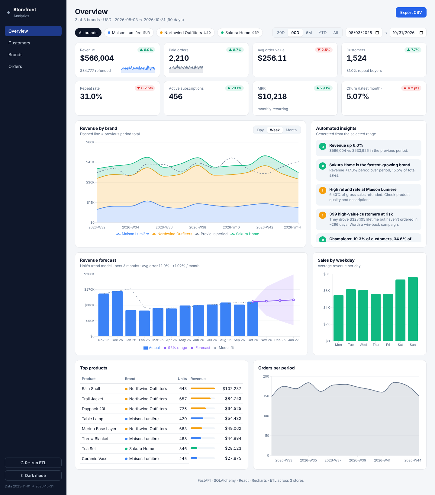
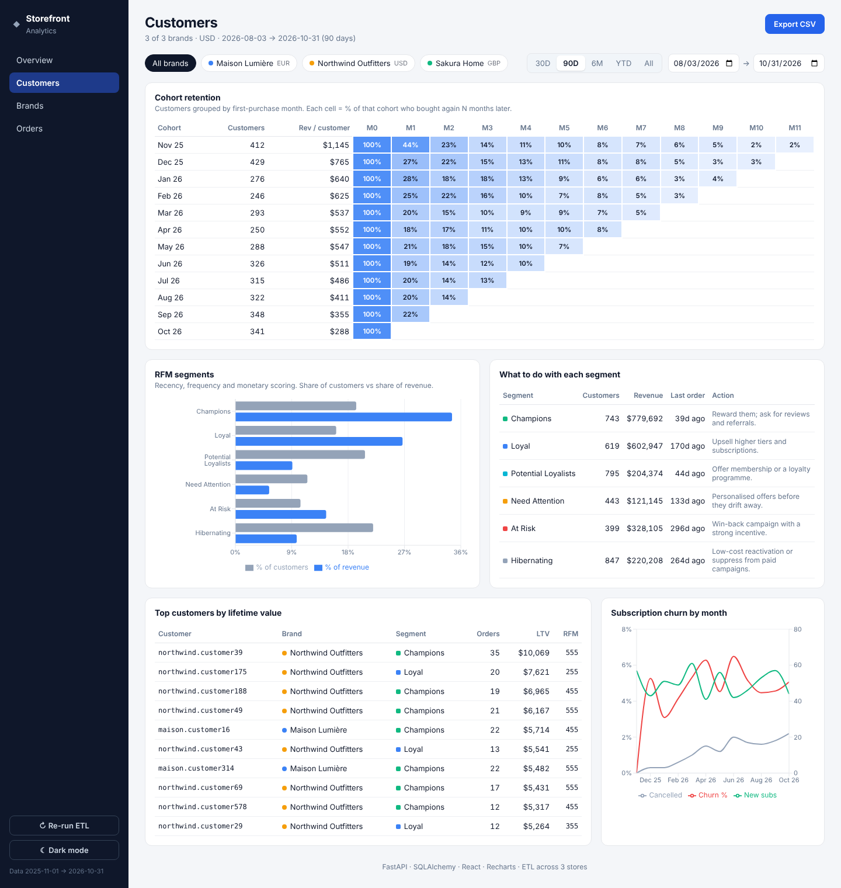
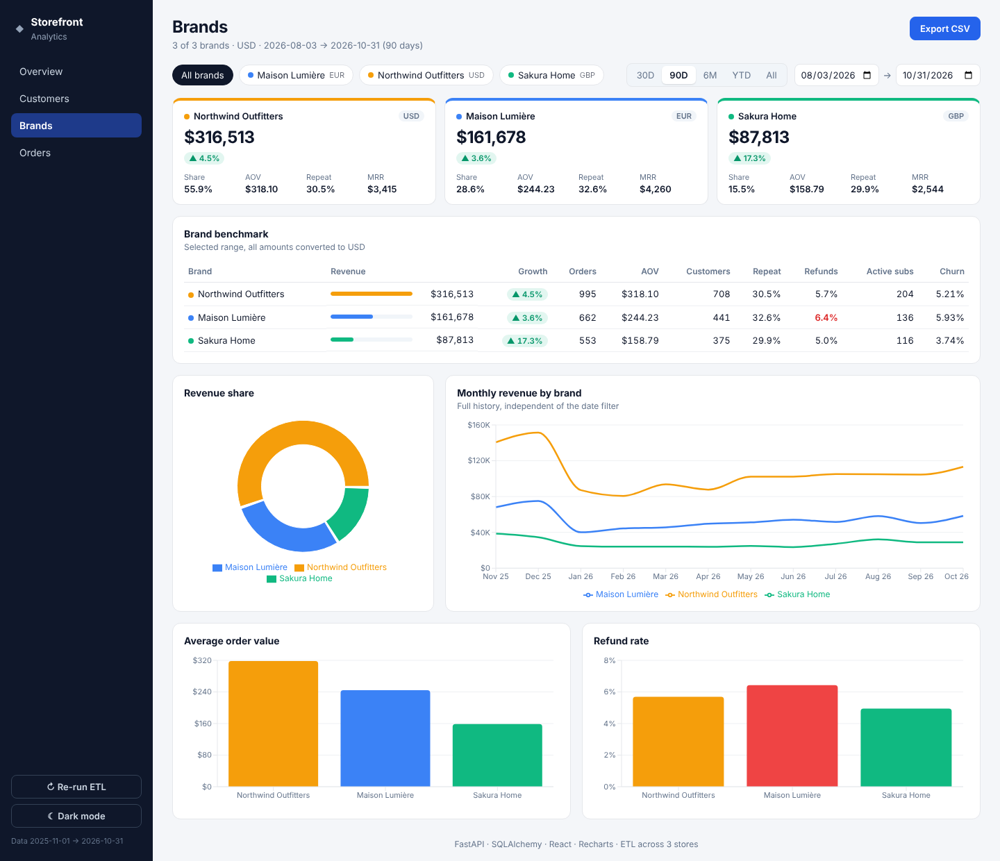
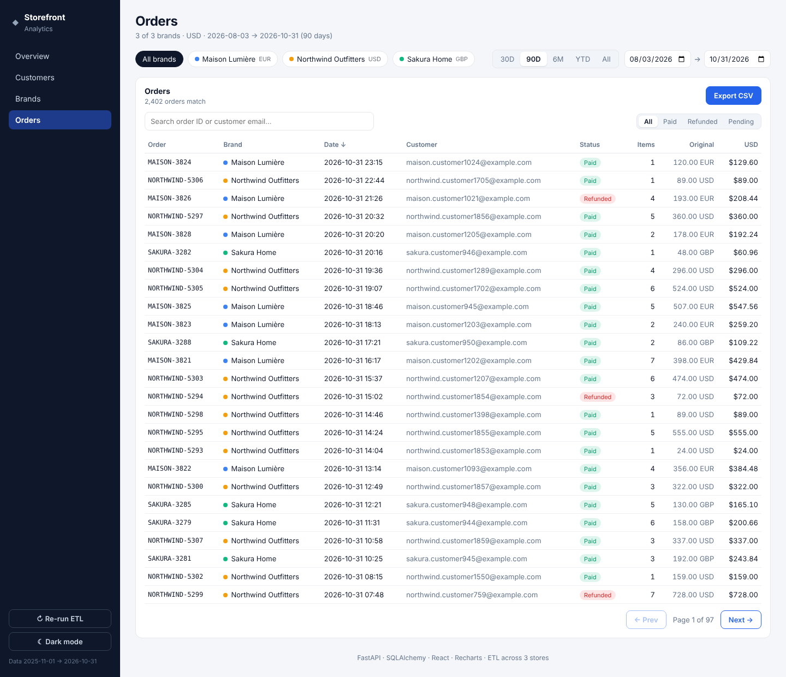
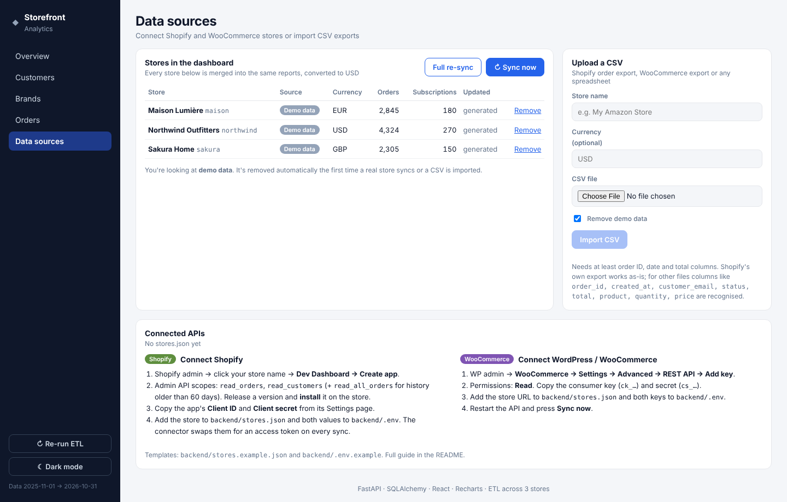
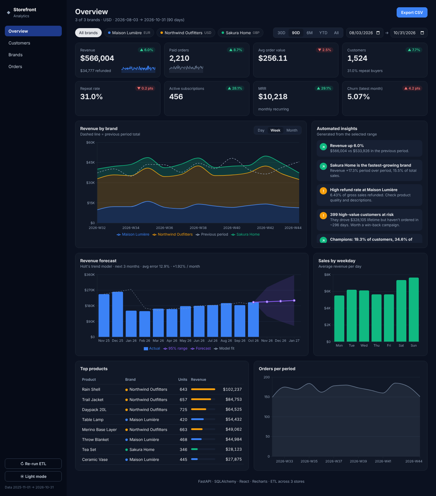

# Multi-Store Sales Analytics Dashboard

A reporting platform for a business that runs several e-commerce brands.

- **Connectors** pull orders and subscriptions from **Shopify** (Admin GraphQL API), **WordPress / WooCommerce** (REST API) or any **CSV export**.
- A Python ETL pipeline cleans the data, converts every amount to USD and loads one reporting schema.
- A FastAPI service turns that data into business metrics, forecasts and customer segments.
- A React dashboard presents it in five views: Overview, Customers, Brands, Orders and Data sources, with light and dark themes.



## What's inside

### Overview
- **8 KPI cards** compared with the previous period of the same length (▲ / ▼ deltas), with sparklines. Rates such as churn and repeat rate change in percentage points, not percent.
- **Stacked revenue by brand**, by day, week or month, with the previous period drawn as a dashed line.
- **Automated insights** written from the data:
  - which brand is growing fastest or declining
  - refund-rate warnings
  - high-value customers at risk
  - the size of the Champions segment
  - next month's forecast
  - the best weekday
- **Revenue forecast** for the next 3 months, using Holt's linear trend (double exponential smoothing). The smoothing parameters are chosen automatically, and the chart shows a 95% prediction band and the model's average error.
- **Sales by weekday**, **top products** and **orders per period**.

### Customers
- **Cohort retention heatmap.** Customers are grouped by the month of their first purchase. Each cell shows the % of that cohort who bought again N months later.
- **RFM segmentation.** Each customer is scored on recency, frequency and monetary value and placed in one of 7 segments, from Champions and Loyal through At Risk to Hibernating. Each segment shows its share of customers vs. its share of revenue, plus a suggested action.
- **Top customers by lifetime value**, with their RFM scores.
- **Subscription churn**, with new and cancelled subscriptions per month.

### Brands
- One scorecard per brand: revenue, growth, share, AOV, repeat rate and MRR.
- A benchmark table with orders, customers, refund rate, active subscriptions and churn.
- Charts: revenue-share donut, monthly revenue by brand, AOV and refund-rate comparisons.

### Orders
- Search by order ID or customer email, filter by status, and sort by date, items or value.
- Pagination, and a CSV export of exactly the filtered result.

### Data sources
- **Shopify connector:**
  - authenticates with the Dev Dashboard client credentials grant, or an existing `shpat_` token
  - pages through every order with GraphQL cursors and backs off when Shopify throttles requests
  - also reads subscription contracts when the app has that scope
- **WooCommerce connector:** paginates the REST API, maps WooCommerce order statuses, and reads WooCommerce Subscriptions when the plugin is installed.
- **CSV import:** reads Shopify's own order export as-is, or a generic CSV with common header names (WooCommerce, Amazon or spreadsheet exports).
- **Incremental sync:** after the first full pull, only orders changed since the last sync are fetched and merged.
- **Background sync** runs every N minutes when `SYNC_INTERVAL_MINUTES` is set. A CLI command is also available for cron.
- **Demo data is replaced automatically** the first time a real store syncs.

### Platform
- **Multi-store ETL.** Each brand exports in its own currency (USD, EUR, GBP). The pipeline drops test orders and duplicate orders, normalises emails, converts currencies and pre-computes date buckets.
- **Idempotent loads.** Re-running the ETL never double-counts, and every run is logged.
- **Database-agnostic.** Uses SQLite by default. MySQL or PostgreSQL work through `DATABASE_URL`, because the date buckets are stored as columns and `GROUP BY` doesn't depend on dialect-specific date functions.
- **Global filters.** Choose brands and a date range (presets or custom dates). Every view and export follows them.
- **Tested.** 35 pytest tests cover:
  - ETL rules and the analytics: period comparison, cohorts, RFM, forecasting
  - both connectors, against mocked Shopify and WooCommerce APIs (pagination, auth, status mapping, incremental sync)
  - CSV parsing and every endpoint

  GitHub Actions runs the tests and the frontend build on every push.

| Customers | Brands |
|---|---|
|  |  |

| Orders | Data sources |
|---|---|
|  |  |



## Tech stack

| Layer | Tools |
|---|---|
| ETL & API | Python 3.12, FastAPI, SQLAlchemy 2.0 |
| Analytics | Cohorts, RFM quintile scoring, Holt's exponential smoothing (pure Python, no heavy deps) |
| Database | SQLite (default), MySQL 8 via Docker Compose |
| Frontend | React 19, Vite, Recharts |
| Tooling | pytest, GitHub Actions, Docker |

## Quick start

**macOS shortcut:** double-click `start-mac.command` in Finder. It installs everything, starts both servers and opens the dashboard.

### Backend

```bash
cd backend
python3 -m venv .venv && source .venv/bin/activate   # Windows: .venv\Scripts\activate
python -m pip install -r requirements.txt -r requirements-dev.txt
uvicorn app.main:app --reload
```

On first start, the API generates a year of demo exports for three brands and runs the ETL: Northwind Outfitters (USD), Maison Lumière (EUR) and Sakura Home (GBP). The demo customers behave realistically: new shoppers arrive every day, they have different loyalty levels and they eventually lapse. The API docs are at http://localhost:8000/docs.

### Frontend

```bash
cd frontend
npm install
npm run dev
```

Open http://localhost:5173. To point it at another API, set `VITE_API_URL` (see `.env.example`). Add `?theme=dark` to the URL to open in dark mode.

### With Docker and MySQL

```bash
docker compose up --build
```

## Connecting your stores

The dashboard starts with demo data. To use real data, connect one or more stores. You can mix platforms, and every store becomes a "brand" in the reports.

### 1. Shopify

Since **1 January 2026**, Shopify no longer lets you create new custom apps from the store admin ("Develop apps"). New apps are created in the **Dev Dashboard**, and the connector gets its access token from the app's **Client ID and Client secret** (the *client credentials grant*).

1. In the Shopify admin, click your store name (top right) → **Dev Dashboard** → **Create app**. You can also go to https://dev.shopify.com/dashboard.
2. In the app's configuration, add these **Admin API access scopes**:
   - `read_orders` (required)
   - `read_customers` (required, for customer emails)
   - `read_all_orders` (optional, for orders older than 60 days)
   - `read_own_subscription_contracts` (optional, for subscription metrics)
3. **Release** a version of the app, then **install** it on your store.
4. Open the app's **Settings** page and copy the **Client ID** and **Client secret**.
5. Add the store to `backend/stores.json`:
   ```json
   {
     "stores": [
       {
         "code": "my-shop",
         "name": "My Shopify Store",
         "platform": "shopify",
         "shop": "my-shop.myshopify.com",
         "client_id_env": "SHOPIFY_CLIENT_ID_MY_SHOP",
         "client_secret_env": "SHOPIFY_CLIENT_SECRET_MY_SHOP"
       }
     ]
   }
   ```
6. Put the secrets in `backend/.env`. This file is never committed:
   ```bash
   SHOPIFY_CLIENT_ID_MY_SHOP=your-client-id
   SHOPIFY_CLIENT_SECRET_MY_SHOP=shpss_your-client-secret
   ```

> **Already have a legacy custom app** (created before 2026) or another `shpat_` token? Use `"token_env": "SHOPIFY_TOKEN_MY_SHOP"` instead of the two client fields, and put the token in `.env`. Legacy apps keep working.
>
> The client credentials grant only works for an app created by the same organisation that owns the store. For a client's store, ask the merchant to create the app in their own Dev Dashboard and share the Client ID and secret with you.

### 2. WordPress / WooCommerce

1. In the WordPress admin, go to **WooCommerce → Settings → Advanced → REST API → Add key**.
2. Give it a description, choose a user, set **Permissions: Read**, then click **Generate API key**.
3. Copy the **Consumer key** (`ck_…`) and **Consumer secret** (`cs_…`). They are only shown once.
4. Add the store to `backend/stores.json` (in the same `stores` list):
   ```json
   {
     "code": "my-woo",
     "name": "My WordPress Store",
     "platform": "woocommerce",
     "url": "https://shop.example.com",
     "key_env": "WOO_KEY_MY_WOO",
     "secret_env": "WOO_SECRET_MY_WOO"
   }
   ```
5. Add the keys to `backend/.env`:
   ```bash
   WOO_KEY_MY_WOO=ck_xxxxxxxx
   WOO_SECRET_MY_WOO=cs_xxxxxxxx
   ```

Your site must use **HTTPS** and have pretty permalinks enabled, so that `/wp-json/` works. If the **WooCommerce Subscriptions** plugin is installed, subscriptions are imported too. Otherwise those metrics stay empty.

### 3. Sync

Restart the API. On first start it syncs automatically. After that, you can sync whenever you like:

- **From the dashboard:** go to **Data sources** and click **Sync now**, or **Full re-sync** to pull all history again.
- **From the terminal:**
  ```bash
  cd backend
  python -m app.sync          # incremental: only orders changed since the last sync
  python -m app.sync --full   # pull everything again
  ```
- **Automatically:** set `SYNC_INTERVAL_MINUTES=60` in `.env`, or add a cron job:
  ```bash
  0 * * * * cd /path/to/backend && .venv/bin/python -m app.sync
  ```

The **Data sources** page shows each store's last sync and order count. If a sync fails (wrong key, app not installed, missing scope), it shows the error message too. The demo stores are removed automatically after the first successful sync. Set `"keep_demo_data": true` in `stores.json` to keep them.

### 4. Any other platform: CSV upload

For Amazon, Etsy, BigCommerce, a POS system, or a store you don't have API access to, export the orders as CSV. Then use either:

- **Dashboard:** **Data sources → Upload a CSV**. Enter a store name and an optional currency, then choose the file.
- **Terminal:**
  ```bash
  python -m app.sync --csv orders.csv --name "My Amazon Store" --currency USD
  ```

Two CSV layouts are recognised:

| Layout | Columns used |
|---|---|
| **Shopify order export** (Orders → Export) | `Name`, `Email`, `Financial Status`, `Created at`, `Total`, `Currency`, `Lineitem name`, `Lineitem quantity`, `Lineitem price` |
| **Generic** (one row per order or per line item) | `order_id`, `created_at`, `customer_email`, `status`, `total`, and optionally `product`, `quantity`, `price`, `currency` |

Common alternative headers are accepted too, such as `Order Number`, `Order Date`, `Billing Email`, `Order Status` and `Order Total`. Statuses are mapped like this:

- `completed`, `processing` and `paid` become **paid**
- `refunded` becomes **refunded**
- `pending` and `on-hold` become **pending**
- cancelled and failed orders are ignored

### How it works

```
Shopify GraphQL ─┐
WooCommerce REST ┼─► connector ─► data/sources/<store>.json ─► ETL ─► reporting DB ─► API ─► dashboard
CSV upload ──────┘    (normalise)     (one file per store)        (dedupe, USD,
                                                                   date buckets)
```

Each connector produces the same JSON shape (see `app/connectors/base.py`), so adding another platform means writing one small class with a `fetch()` method and registering it in `app/connectors/__init__.py`.

Currencies are converted with the fixed rates in `FX_TO_USD` in `app/etl.py`, which covers about 25 currencies. Add a rate there if your store uses one that isn't listed.

## Running the ETL manually

```bash
cd backend
python -m app.seed   # regenerate the demo store exports in data/sources/
python -m app.etl    # extract, transform and load
```

The ETL rebuilds the reports from whatever is in `backend/data/sources/`. The **Re-run ETL** button in the sidebar calls `POST /api/etl/run`.

## API

| Method | Endpoint | Description |
|---|---|---|
| GET | `/api/overview` | KPIs for the range, the previous period, and % / pt deltas |
| GET | `/api/insights` | Automated, plain-English insights |
| GET | `/api/forecast?horizon=3` | Holt's forecast with a 95% band, the fitted values and the error |
| GET | `/api/cohorts` | Monthly cohort retention matrix |
| GET | `/api/rfm` | RFM segments, the suggested actions and the top customers |
| GET | `/api/brand-comparison` | Per-brand benchmark, including growth vs the previous period |
| GET | `/api/revenue?bucket=day\|week\|month` | Revenue and orders per period, split by brand |
| GET | `/api/weekday` | Average revenue and orders per weekday |
| GET | `/api/churn` | Monthly subscription churn |
| GET | `/api/top-products` | Best sellers by revenue |
| GET | `/api/orders/search` | Search (`q`), `status`, `sort`, `direction`, pagination |
| GET | `/api/export/orders.csv` | CSV export using the same filters |
| GET | `/api/summary`, `/api/brands`, `/api/meta` | Raw KPIs, the brand list, the data range |
| POST | `/api/etl/run` | Re-run the pipeline |
| GET | `/api/sources` | Stores in the dashboard, configured APIs and last sync results |
| POST | `/api/sync?full=false` | Sync every store in `stores.json`, then rebuild the reports |
| POST | `/api/sources/csv` | Upload a CSV (`file`, `name`, optional `currency`) |
| DELETE | `/api/sources/{code}` | Remove a store's data |
| POST | `/api/sources/demo` | Load the demo stores again |

Most endpoints accept these filters:

- `brand`: one or more brand codes, comma-separated (for example `northwind,sakura`)
- `start` and `end`: dates in `YYYY-MM-DD` format

## Tests

```bash
cd backend && pytest -q
```

## Project structure

```
backend/
  app/
    db.py          # schema + engine (SQLite / MySQL / Postgres)
    seed.py        # demo store exports with a realistic customer lifecycle
    etl.py         # extract, transform, load
    analytics.py   # core reporting queries
    advanced.py    # comparison, cohorts, RFM, forecast, benchmark, insights, search
    connectors/    # shopify.py, woocommerce.py, csv_import.py, base.py
    sources.py     # stores.json, sync orchestration, CSV import, demo handling
    sync.py        # CLI: python -m app.sync
    main.py        # FastAPI routes
  stores.example.json  # copy to stores.json
  .env.example         # copy to .env
  tests/
frontend/
  src/
    App.jsx        # shell, sidebar, global filters, theme
    pages/         # Overview, Customers, Brands, Orders, Sources
    components.jsx # KPI cards, deltas, insights, cards
```

## Notes

- Currency conversion uses fixed reference rates in `etl.py`, so reports are reproducible. In production you would swap in a rates API.
- Revenue counts paid orders only. Refunds are reported separately.
- The forecast is deliberately simple and explainable. With more than a year of history, a seasonal model (Holt-Winters) would capture holiday peaks.
